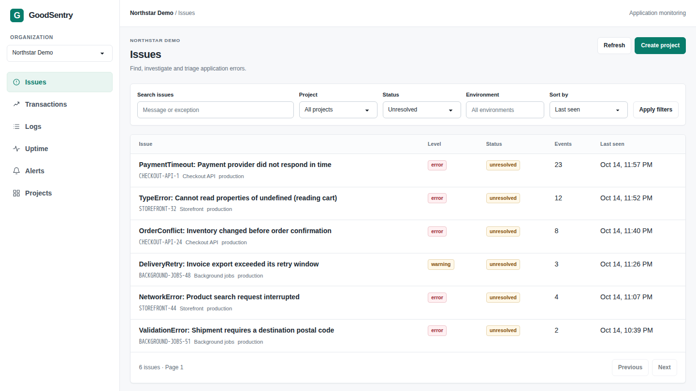

<p align="center">
  
</p>

<h1 align="center">GoodSentry</h1>
<p align="center"><strong>Sentry SDKs. One Go service.</strong></p>
<p align="center">Self-hosted error tracking, logs and uptime.<br>One application container, backed by PostgreSQL.</p>

<p align="center">
  <a href="https://github.com/jerolan/good-sentry/actions/workflows/ci.yml"></a>
  
  
  
</p>

<p align="center">
  <a href="https://jerolan.github.io/good-sentry/">Website</a> ·
  <a href="#quickstart">Get started</a> ·
  <a href="docs/README.md">Documentation</a> ·
  <a href="tasks/todo.md">Roadmap</a>
</p>

<p align="center">
  
</p>
<p align="center"><sub>Actual GoodSentry interface. Fictional demo data.</sub></p>

GoodSentry is an independent Go implementation of Sentry-compatible error tracking. Connect your existing Sentry SDK with a GoodSentry project DSN. The same Go process serves the Tailwind CSS + daisyUI interface, receives telemetry, checks uptime and delivers alerts. PostgreSQL stores the data and coordinates background work.

## Quickstart

You need Git and Docker with Compose. On Windows, use a WSL2 distribution integrated with Docker Desktop.

```sh
git clone https://github.com/jerolan/good-sentry.git
cd good-sentry
docker compose up -d
```

Open **http://localhost:8000**. The default open mode signs you in as the implicit local owner, so the dashboard is ready immediately. Create a project and copy its DSN into your SDK configuration.

Open mode is intended for local use or a trusted private network. With no `.env`, GoodSentry generates and keeps a random application key in its uploads volume. Before exposing it, configure a persistent `SECRET_KEY` and set `GOODSENTRY_AUTH=required` in `.env`, then restart Compose; the normal setup, login and account flows take over. Compose pulls the public application image for amd64 or arm64. See [installation details](docs/getting-started.md) and the [configuration reference](docs/configuration.md).

## Connect your SDK

For an existing Sentry integration, start by changing its DSN. Keep your application's existing sampling settings. A minimal Node.js example:

```js
import * as Sentry from "@sentry/node";

Sentry.init({ dsn: process.env.SENTRY_DSN });
Sentry.captureException(new Error("Hello from GoodSentry"));
```

Official Go `0.50.0`, Python `2.72.0`, Node.js `11.7.0` and Browser JavaScript `11.7.0` clients have verified error, transaction and typed-log workflows. See [SDK compatibility](docs/compatibility.md#sdk-compatibility) for the tested scope, settings and limits.

Try a runnable client app in [examples/sentry-go](examples/sentry-go/README.md). It uses the official Go SDK and sends an exception to the DSN you copied from GoodSentry.

For interactive source-map setup, run `npx @sentry/wizard@8.0.1 --url http://localhost:8000/` and approve the short-lived handoff in the browser. The wizard receives a project DSN and a temporary credential with release-upload access.

## Features

| Capability | Available workflows |
| --- | --- |
| Errors and feedback | Grouped issues, stack traces, tags, search, assignment, comments, triage, SDK feedback and a DSN-bound embed error page. |
| Releases | Sentry CLI lifecycle operations, commit/deploy metadata, JavaScript source maps and compatible release-file list/detail/delete. |
| Native diagnostics | Official CLI chunked DIF upload, bounded ZIP/TAR/gzip-TAR debug archives, AMD64/x86/ARM32/ARM64/RISC-V64 Minidump symbolication, and frame-pointer, DWARF CFI and ARM EHABI unwinding. RISC-V64 recovery covers Crashpad/Breakpad context v1 integer state, not floating-point/vector/CSR or platform signal contexts. Supported symbols include Breakpad, ELF/DWARF, Mach-O/dSYM, classic PDB and SymCache v7-v9; real crash-provider receipts remain open. |
| Performance and logs | Transactions, spans, trace waterfalls, compatible transaction-group/detail/trend/span, N+1, Grafana `stats_v2` and compatible log list/detail/resource/stat reads, typed logs and OTLP/HTTP log ingestion. |
| Uptime and alerts | HTTP, TCP, SSL certificate and heartbeat monitors with compatible heartbeat endpoints, public status pages; email and webhooks with durable retries. |
| Cold span storage | Optional local or S3-compatible Parquet archive; old spans remain queryable and expire on the same transaction-retention deadline. |
| Accounts and teams | Password changes, email recovery, optional TOTP two-factor sign-in with single-use recovery codes, GlitchTip-compatible account API tokens, recovery codes and invitation acceptance, verified secondary sign-in addresses, Account-page deletion with typed confirmation, optional instance OIDC, per-organization OpenID Connect sign-in applications, member roles, single-use invitations, atomic owner transfer and multi-team projects. |
| Integration API | Sentry-compatible discovery and management for users, organizations, projects, members, teams and environments; `sentry-wizard` handoff, current-account deletion with sole-owner protection, opt-in organization creation, organization rename/delete, member invitation/cancellation, project-team associations, project event sampling, project-key DSNs with rate limits, plus scoped automation credentials. Optional generated OpenAPI docs and instance-admin account management are available behind explicit flags. |
| MCP | Opt-in Model Context Protocol server with 17 organization, issue, log, alert, monitor and performance tools; OAuth PKCE or scoped API tokens. |
| Deployment | One non-root application image, PostgreSQL, automatic migrations, cookie-free local open mode and an opt-in `required` setup/login mode for public exposure. |

Optional **Administration** provides organization-level operational summaries and, for separately granted instance administrators, account activation and access management. See the [configuration guide](docs/configuration.md) for the existing-install bootstrap command and the required-auth mode for multi-user deployments.

## Documentation

- [Getting started](docs/getting-started.md) — installation and first project.
- [Configuration](docs/configuration.md) — environment variables and scoped API tokens.
- [Product guides](docs/README.md) — issues, feedback, releases, observability and retention.
- [Compatibility and status](docs/compatibility.md) — verified workflows and remaining gaps.

## Project status

GoodSentry is in active development. **Full Sentry compatibility and GlitchTip feature parity are not complete.** Remaining work includes broader native crash formats, remaining management routes, repository integrations, social-provider setup, advanced administration and final requirement auditing. The [website](https://jerolan.github.io/good-sentry/) shows the current interface feature by feature; the [compatibility guide](docs/compatibility.md) describes tested workflows and limits.

## Development

Use Go **1.27.2**. Frontend assets are embedded, so local Go builds do not require Node.

```sh
go test ./...
go vet ./...
go build -trimpath -o bin/goodsentry ./cmd/goodsentry
```

See the [development guide](docs/development.md) for PostgreSQL integration/race tests, pinned frontend tooling and GitHub Pages publishing.

## Independent implementation

GoodSentry is developed from public protocol specifications, official documentation and black-box tests with official SDKs and the CLI. Protocol references, design decisions and verification limits are recorded in [SPEC.md](SPEC.md). Its original dashboard styling is inspired by the [Nexus daisyUI examples](https://nexus.daisyui.com/).
